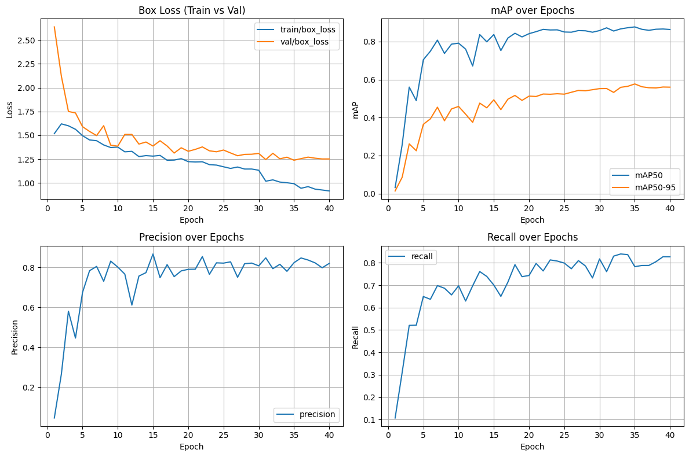

# Crop & Weed Detection with YOLOv8

Detects crops and weeds in field images and counts each class per image, using a YOLOv8m model fine-tuned from pre-trained weights.

**Notebook:** [`crop_weed_detection_yolov8.ipynb`](crop_weed_detection_yolov8.ipynb)

## Problem

Given field photos, localize and classify every plant as `crop` or `weed` (2 classes), so weed density can be estimated per image.

## Data

[Kaggle: crop and weed detection data with bounding boxes](https://www.kaggle.com/datasets/ravirajsinh45/crop-and-weed-detection-data-with-bounding-boxes), downloaded in the notebook with `kagglehub`. Images and YOLO-format labels are reorganized into `images/{train,val}` and `labels/{train,val}` with a random 90/10 split. The notebook also checks that every image has a matching label file and prints class counts for the training labels.

## Approach

- Model: YOLOv8m (Ultralytics), initialized from pre-trained `yolov8m.pt` weights and fine-tuned
- Training: 40 epochs, batch size 8, 640 px images, early stopping enabled (patience 10, not triggered); about 10 minutes on a single NVIDIA A100 in Colab
- Evaluation: mAP50, mAP50-95, precision and recall on the validation split, plus loss/mAP/precision/recall curves from `results.csv`
- Inference: predictions at confidence 0.5 with saved sample outputs
- Counting: `detect_and_count()` returns per-class counts for an image (e.g. `{crop: n, weed: m}`)
- Efficiency: reports weights size (MB) and Ultralytics' per-image speed

## Results

Evaluated on the 130-image validation split (238 labeled objects); the training split has 1,170 images (1,054 crop and 780 weed boxes).

| Class | Precision | Recall | mAP50 | mAP50-95 |
|---|---|---|---|---|
| **All** | **0.810** | **0.799** | **0.878** | **0.576** |
| Crop | 0.739 | 0.759 | 0.829 | 0.558 |
| Weed | 0.882 | 0.839 | 0.926 | 0.595 |

- Model size: 49.6 MB (`best.pt`), 25.8M parameters, 78.7 GFLOPs
- Speed (A100, 640 px): about 4 ms/image inference during validation and about 9 ms/image during batch prediction, as reported by Ultralytics

Sample predictions and the per-image crop/weed counting demo are in the notebook outputs.

## Limitations

- The validation split doubles as the test split, and the inference demos run on images from the training folder, so the numbers describe in-distribution performance on this one dataset only.
- The notebook's own FPS benchmark cell found no images (its file pattern matched `.jpg` but the images are `.jpeg`), so the speed figures above come from Ultralytics' built-in timing instead.
- Crop is detected less reliably than weed (mAP50 0.829 vs. 0.926).

## Run it

Open the notebook in Google Colab with a GPU runtime. The first cell installs `ultralytics kagglehub opencv-python pyyaml matplotlib seaborn pandas`.